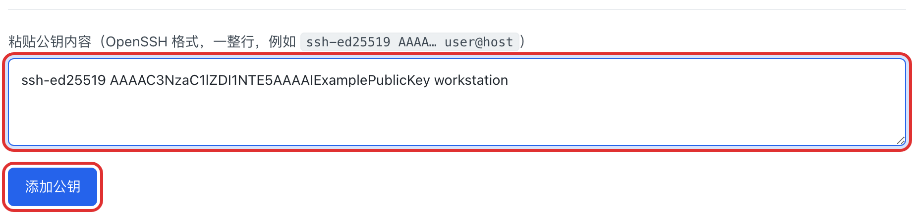
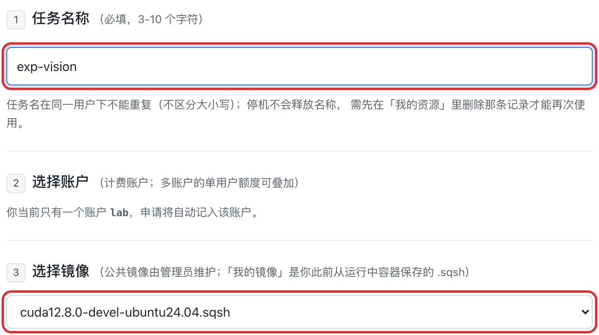
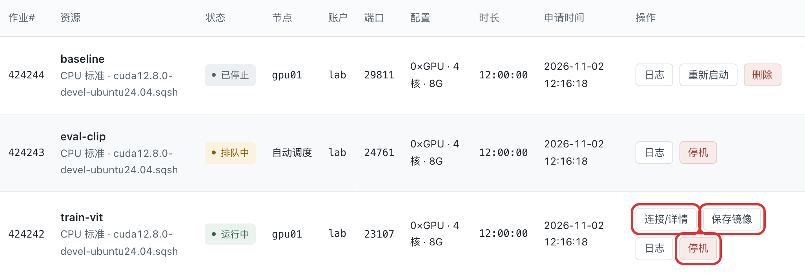

# 平台使用指南

在网页申请计算资源，连接容器开展实验；也可以安装终端工具，让 Codex 等 agent 完成同样的用户操作。

## 首次使用

1. 向管理员获取平台账号和初始密码，连接实验室网络后登录。
2. 点击右上角头像，进入“个人资料”，修改初始密码。
3. 添加你准备连接容器的电脑上的 SSH 公钥。已有密钥时，直接复制 `.pub` 文件的整行内容；只上传公钥，私钥留在自己电脑上。

没有密钥时，在本机终端生成：

```bash
ssh-keygen -t ed25519
cat ~/.ssh/id_ed25519.pub
```

如果提示已有同名密钥，保留原文件或换一个文件名。添加公钥后即可申请资源，SSH 端口由平台自动分配。



## 申请与连接

打开“申请资源”，按页面顺序填写：

| 项目 | 怎么选 |
|---|---|
| 任务名称 | 3–10 个字符，同一账号下不能重复，不区分大小写 |
| 账户 | 有多个账户时选择本次任务使用的账户；只有一个时自动使用 |
| 镜像 | 首次可选公共镜像；已有环境可选个人镜像 |
| 套餐 | 按实验需要选择 CPU、GPU 和内存规格 |
| 时长 | 不超过所选套餐上限 |
| 节点 | 一般保留“自动分配”；需要指定机器时再选择 |



提交后回到“我的资源”：

- **排队中**：等待调度分配资源。
- **启动中**：容器和 SSH 服务正在准备，稍后再连接。
- **运行中**：点击“连接/详情”，复制平台给出的 SSH 命令，在本机终端执行。

连接时使用已登记公钥对应的私钥。平台登录密码不用于容器 SSH 登录。连接失败时先打开“日志”查看启动信息和门户操作结果。



任务停止后名称仍被记录占用；删除这条已结束记录后，才可以再次使用该名称。

## 运行环境与存储

**本系统以容器为核心**：每个资源都是一个独立容器，代码、训练和调试都在容器内进行；镜像决定环境，保存镜像用于保留修改。

分发给用户的容器拥有**完整的 root 权限**。在容器内执行 `su -`，输入 root 密码 `218` 即可切换到 root。日常操作建议先用普通用户，只有安装系统包、修改系统配置等需要时才切换；该 root 仅限容器内，不是宿主机 root。

基础容器已预装 Miniconda，路径为 `/opt/miniconda3`。进入容器后使用：

```bash
source /opt/miniconda3/etc/profile.d/conda.sh
conda --version
conda create -n myenv python=3.11
conda activate myenv
```

不需要在家目录重复安装 Miniconda。Conda 环境建议创建在容器内的 `/opt/miniconda3` 下；需要长期保留时，将容器保存为个人镜像。

**家目录 `/share/home/<用户名>` 建议只存放代码和小型配置。** 不要把大型数据集、conda 环境、checkpoint 或大量结果文件放在 home：它走 NFS 并计入你的磁盘配额。需要的数据直接从只读 NAS（`/mnt/nas/...`）读取，不要整份复制到 home；代码和少量重要文件会随 home 持久保存。

## 保存环境与结束任务

安装了软件、修改了容器环境，想下次继续使用时：

1. 在运行中的资源上点击“保存镜像”，填写名称并确认。
2. 等待资源行显示保存成功；镜像打包可能需要几分钟。
3. 在“我的镜像”确认新镜像已出现，再按需要停机。

保存的是容器文件系统，不保存运行中进程和内存，也不备份挂载目录中的实验数据。**单个个人镜像上限为 20 GiB**：保存前会检查容器 rootfs，导出后再次检查 `.sqsh`；超过上限的保存会被拒绝。**不要把 ckpt、大数据或大量临时文件放在容器根目录**，它们会计入 rootfs 和镜像；到期自动保存若失败，系统会放弃保存并直接停机。

| 操作 | 结果 |
|---|---|
| 停机 | 取消当前作业、释放计算资源；**不会先自动保存环境** |
| 重新启动 | 按原参数和原镜像重新提交，SSH 端口重新分配；不会恢复未保存的容器修改 |
| 删除 | 删除已结束资源的记录和对应作业日志，不等同于删除个人镜像 |

到期自动保存**默认关闭**：资源到期后会直接停机，不生成 `auto_` 镜像；需要保留环境请在到期前手动「保存镜像」。管理员可在 `/etc/cluster-portal/site.conf` 设置 `AUTO_SAVE_ON_EXPIRE=1` 重新开启。被抢占的作业不会自动保存。

## 管理镜像

“我的镜像”区分两类：公共镜像由管理员维护，普通用户只读；个人镜像来自你保存的容器环境，存放在站点镜像目录（本站为 `/images`，独立盘，不占用 `/share` 家目录配额）。单个个人镜像上限 20 GiB。

个人镜像可以编辑注释、重命名和删除。镜像被排队中的任务使用时不能重命名；被排队或运行中的任务占用时不能删除。删除镜像后，引用它的旧资源无法再直接“重新启动”。

再次使用保存好的环境：打开“申请资源”，在镜像下拉框的“我的镜像”分组选择它。

## 查看集群、额度与资料

- **集群 → 集群占用情况**：按分区与 GPU 型号查看 CPU、内存、GPU 的空闲/总量，采用 Slurm 调度口径。
- **集群 → 门户内活跃资源**：查看通过门户提交的活跃任务及截止时间。
- **我的资源 → 我的配额 / 额度**：查看磁盘已用量、硬上限，以及各账户的优先级和单用户 GPU 上限。任务使用申请时选择的账户。
- **个人资料**：添加或删除 SSH 公钥、修改显示名和平台密码。修改密码后，旧终端凭证失效，需要重新登录。

额度、套餐、账户归属和账号状态由管理员维护。遇到上限不足或账户不可用，请联系管理员。

## 角色权限对照

| 功能 | 普通用户 | 管理员（非 root） |
|---|---|---|
| 登录、个人资料、SSH 公钥、改密码 | ✅ | ✅ |
| 自助申请资源（普通） | ✅ | ✅ |
| 管理自己的资源：连接、日志、停机、重启、删除 | ✅ | ✅ |
| 查看公共镜像和自己的镜像 | ✅ | ✅ |
| 管理自己的个人镜像：注释、改名、删除 | ✅ | ✅ |
| 查看集群占用、活跃资源和自己的额度 | ✅ | ✅ |
| 代申请资源（特权） | — | ✅ （可代普通用户申请） |
| 开通普通用户 | — | ✅ |
| 重置/停用/删除普通用户、修改普通用户配额 | — | ✅ |

管理员不能管理其他管理员或 root，也不能停用/删除其他管理员；普通用户只能操作自己的资源和个人镜像。

## 安装命令行工具

OrbitCluster CLI 面向用户和 agent，没有 TUI。支持 macOS、Linux、WSL 和原生 Windows，客户端无需 Python、pip、Git 或 Go。服务器仍沿用现有 Python 后端。

打开门户「使用文档 → 终端工具使用」，选择运行终端并点击“复制安装命令”。安装脚本和平台压缩包仅从你们门户下载，显示下载进度、SHA256 校验和安装结果。HTTP 默认支持，不再需要勾选开关。HTTP 明文传输密码和令牌，仅在实验室可信内网使用；HTTPS 仍校验证书。

安装后本人在真实终端隐藏输入密码，再交给 agent 查询：

```bash
orbit login --username 你的用户名
orbit whoami --json
orbit instances list --json
orbit images list --json
orbit --help
```

认证固定七天，以服务器返回的到期时间为准；到期重新登录，无 Cookie、无自动续期。关闭 CLI 不会停止作业。macOS/Linux 启动器默认 `~/.local/bin/orbit`；Windows 默认 `%LOCALAPPDATA%\OrbitCluster\bin\orbit.exe`。找不到命令时用完整路径或将对应 bin 目录加入用户 PATH。

更新时重新运行安装命令。卸载前可先注销服务器令牌：

```bash
orbit logout
orbit uninstall
# 同时清除本机配置与登录：
orbit uninstall --purge
```

卸载默认保留配置，purge 只清除已知本机文件；不会停止任务或删除服务器数据。不要将密码或 `auth.json` 发给 agent 或提交到仓库。写请求超时先查询结果，再决定是否重试。

服务器需部署终端 API 和客户端发布包。部署默认 `TERMINAL_REQUIRE_HTTPS=0`；如果服务器保留了旧的显式 HTTPS-only 配置或环境覆盖，需要管理员调整后重启门户。详细安装、平台区别与管理员发布步骤见 [terminal/README.md](../terminal/README.md)。

## 常见问题

**为什么不能提交申请？** 先确认已添加 SSH 公钥，任务名没有重复，时长不超过套餐上限，且所选账户仍有效。

**为什么一直排队？** 可能暂时没有满足套餐、节点或账户限制的资源。查看“集群占用情况”；不要反复提交相同任务。

**SSH 连接不上？** 确认资源已运行，使用最新“连接/详情”里的命令，网络能访问节点，并持有已登记公钥对应的私钥。重新启动后端口会变化。

**镜像保存失败？** 先查资源日志和磁盘配额。确认保存成功前，不要把停机当作已保存。

**终端登录过期？** 重新执行 `orbit login --username 你的用户名`。调整本机时间不能延长有效期。

---

编辑说明：指南已实现于 `/guide`，包含章节目录、安装命令生成与复制。2026-11-02 用户确认页面整体后，在微调后的界面截取了三张带红框的关键操作图；图片全部来自本机模拟集群和演示数据。

## 新导航与共有资产

左侧“任务、集群、资产、使用文档”分组默认展开，可单独折叠；手机上点击“菜单”打开导航。右上角头像中提供个人资料和退出登录。管理员入口仍按原有角色权限展示。

“资产 → 数据集 / 模型仓库”面向共有资产，目前显示“功能待完善”。当前版本不读取资产目录、不展示虚构用量，也没有后台扫描或每日统计任务；后续接入后再启用。镜像管理保留现有操作和权限。

使用文档分别提供“快速入门、平台开发文档、终端工具使用”。安装器和 Codex skill 的安装步骤见独立终端页面 `/guide/terminal`；skill 源文件位于 `skills/orbitcluster/SKILL.md`。
